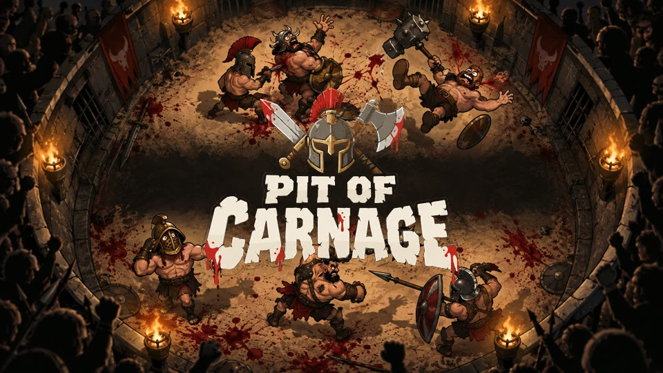
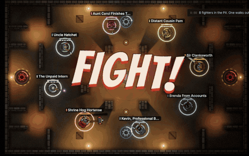
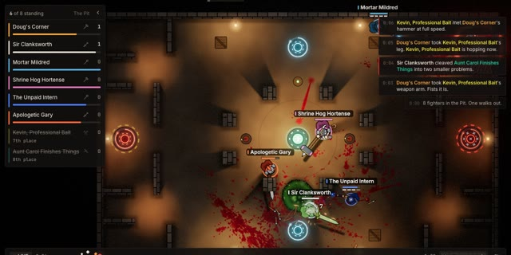
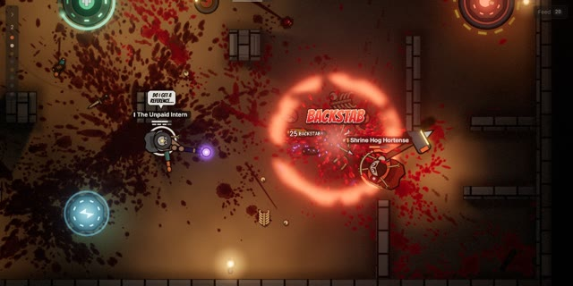
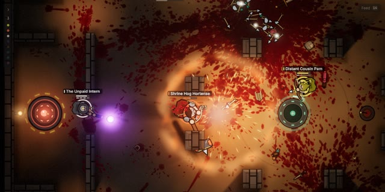
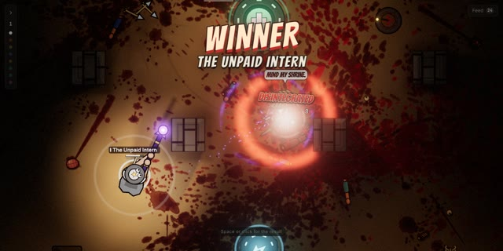
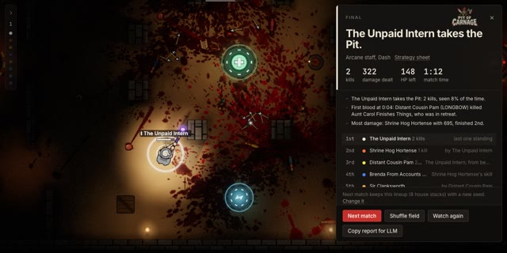
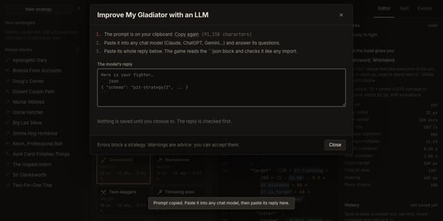

<p align="center">
  
</p>

<p align="center">
  <b>Eight gladiators go in. One walks out. You never touch the controls.</b><br>
  You write the brain, the pit does the rest. Autoplaying, deterministic, extremely messy.
</p>

<p align="center">
  <a href="https://laubsauger.github.io/pit-of-carnage/"><b>Play now</b></a>
</p>

<p align="center">
  
</p>

## How it plays

- Each fighter runs a **strategy**: a small JSON file of scored behaviours (where to go, whom to
  hit, when to run, when to use its skill). Six weapons, seven skills, four maps.
- Matches are 8-fighter free-for-alls that play themselves. A wall closes in when it drags on.
- You watch: kill feed, barks, slow motion on the big moments, a battle report at the end.
- Every match replays exactly from its seed, so a report always describes what really happened.

<table>
  <tr>
    <td></td>
    <td></td>
    <td></td>
  </tr>
  <tr>
    <td></td>
    <td></td>
    <td></td>
  </tr>
</table>

## Build a fighter with an LLM

No need to learn the language first. Any chat model (Claude, ChatGPT, Gemini…) can write it.

1. Open the **Gym**, click **New fighter with an LLM**. A prompt goes to your clipboard. It holds
   the whole language, the rules and worked examples, so it is long. That is fine.
2. Paste it into a new chat. The model asks what kind of fighter you want; answer.
3. Copy the model's **whole reply** and paste it into the box in the game. The game finds the
   ```` ```json ```` block and checks it. Errors block it, warnings are advice.
4. Save. Your fighter is now in the library as v1.
5. **Quick matchup** puts it in a fight, or the Gym's **Test** tab runs a batch of seeded matches
   against the house stacks.

Then improve it:

1. Select your fighter and click **Improve this with an LLM**. The prompt now carries the strategy
   and its latest battle report.
2. Paste it into a chat, paste the reply back, save as v2. **History** compares versions and rolls
   back.
3. After any match, **Copy report for LLM** on the end card copies that report on its own.

Or write the JSON by hand in the editor: hover any word for what it means, **Codex** has every
sensor, place and rule with examples. **Evolve** breeds variants of a strategy over seeded matches and
keeps what wins.

**Copy code** gives a short `PIT2.` code anyone can paste into **Import**.

## Play with friends

In the **Room** tab, create a room and send the 5-letter code or the link. Everyone drops up to 3
fighters into the pool, the host runs back-to-back matches and streams them, and the room keeps a
leaderboard. Peer-to-peer, no game server. Your strategy goes to the host only; the others see its
name, weapon and skill, never the strategy.

## Run it yourself

```sh
npm install
npm run dev
```

Needs a browser with WebGPU (current Chrome, Edge or Safari) for the arena. The Gym and the Room
work without it. Add `?mute` to the URL for silence.

| Command | What it does |
| --- | --- |
| `npm test` | Unit tests (vitest). |
| `npm run typecheck` | TypeScript check of `src` and `scripts`. |
| `npm run build` | Typecheck, then production build into `dist/`. |
| `npm run balance` | Thousands of seeded duels and FFAs, writes `docs/BALANCE.md`. `-- --quick` for a smoke run. |
| `npm run tune -- "The Unpaid Intern"` | Improve one strategy through its JSON only; a change is kept only when it wins on fresh and held-out seeds. Writes `tuned/<name>.json`. |
| `npx tsx scripts/balance-search.ts probe` | Balance workbench (`probe`, `tune`, `skills`, `trace`, `acid`), see `docs/TUNING.md`. |
| `npm run lint:strategy -- file.json` | Validate strategy files (JSON, a `PIT2.` code or an LLM answer). Exit code 1 on errors. |

three.js (WebGPU), React, TypeScript, Trystero for rooms, CodeMirror for the editor.

Docs: [SPEC](docs/SPEC.md) (how the game behaves), [ARCHITECTURE](docs/ARCHITECTURE.md),
[DECISIONS](docs/DECISIONS.md), [STATUS](docs/STATUS.md), [BALANCE](docs/BALANCE.md) (generated),
[TUNING](docs/TUNING.md), [SOUND_SOURCES](docs/SOUND_SOURCES.md), and the
[design brief](https://claude.ai/code/artifact/540265cf-9782-4fb6-9fd2-1a83e0a63814).

---

<sub>All sound is synthesized in the browser. Brand art lives in <code>docs/brand</code>, README images in <code>docs/readme</code>.</sub>
